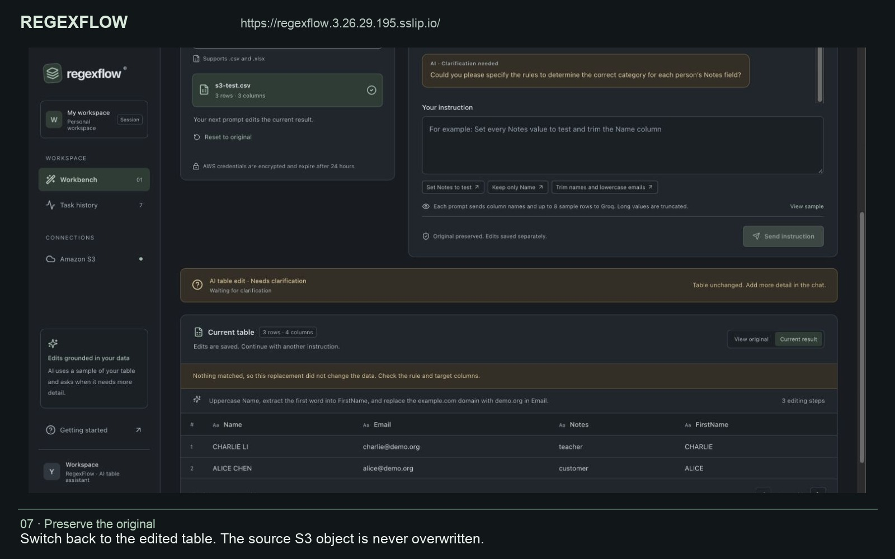

# RegexFlow — AI Table Assistant

A Django + React application that imports CSV/XLSX from a user's own Amazon S3 bucket and edits the table through **one conversation box**. The model sees bounded table samples and the user's instruction, chooses columns and a multi-step editing plan, then Celery/PySpark executes the validated plan. Ambiguous requests ask a follow-up question without changing data.

## Live application

**[Open the deployed RegexFlow application](https://regexflow.3.26.29.195.sslip.io/)**

The application runs on AWS EC2 in Sydney with HTTPS. Connect your own S3 bucket to import CSV/XLSX files; the interface uses the configured Groq provider for conversational edits. The address depends on the current server IP and must be updated if that IP changes.

## Demonstration video

[](docs/demo/regexflow-demo.mp4)

**[Watch or download the MP4](docs/demo/regexflow-demo.mp4)** · [English captions](docs/demo/captions.vtt) · [Recording notes and chapters](docs/demo/README.md)

Recorded against the live deployment on 18 October 2026, using a real S3 CSV with three synthetic records. The video demonstrates file selection, asynchronous import and progress, pagination, regex email-domain replacement, uppercase normalization, first-name extraction, a request for missing category rules, and original/result comparison. It includes English captions and narration. AWS credential entry is omitted, and waiting periods are edited for brevity. A repeated AI-generated domain rule and its no-match warning are shown and explained. Click the image or MP4 link to open the recording; GitHub may offer a download rather than an inline player.

## Current interaction

1. Connect S3 and import a CSV/XLSX, or load the synthetic demo table.
2. Enter a desired result, e.g. `Set Notes to test and trim Name`.
3. No operation tabs, target-column selection or replacement-value form are required. The AI decides these details from the table and instruction.
4. A clear request is executed asynchronously. An unclear request enters `NEEDS_INPUT` and displays a specific question in the conversation.
5. Answer in the same box. Further edits use the current successful result, preserving earlier changes. **View original** previews the source; **Reset to original** resets the editing basis and conversation.

Supported plan steps include assignment, conditional assignment, regex replacement/extraction, text normalization, exact value mappings, filling blanks, column selection/renaming, row filtering, arithmetic with a constant, concatenation, deduplication and sorting. The AI cannot execute Python, SQL or shell code. Requests that cannot be reliably expressed by these operations should ask for a clearer deterministic rule rather than perform an unrelated approximation. This is not an unrestricted per-cell generative rewrite engine.

User guides: [Getting started](GETTING_STARTED.md), [Table assistant](docs/TABLE_ASSISTANT.md), and [AI setup](docs/AI_SETUP.md).

## What is sent to the AI

The configured provider (currently Groq) receives column labels, total row count, the instruction, recent conversation and **up to eight representative sample rows** from the current table. The sampler reads multiple persisted page positions, caps each cell at 160 characters and the serialized table context at 6 KB. Small tables can be included completely; larger/truncated samples are labeled. **View sample** shows the same deterministic sample before sending.

**Table cell contents are now sent to the model provider**, as explicitly requested for this version. The complete million-row table is not transmitted. Credentials from connection/configuration forms are never added to table context; values already contained in a table cell are part of the authorized data sample. The model is instructed to treat cell contents as data rather than instructions. Samples are not logged or duplicated into job metadata; generated plans are cached for 24 hours using a digest of provider, model, table identity/content, conversation and prompt, avoiding cross-table cache confusion.

The previous, column-label-only three-mode API remains for backwards compatibility with old tasks and test scripts. It is not exposed in the current web UI.

## Start with Docker

Prerequisites: Docker Desktop running, Docker Compose v2 and Python 3. Allocate approximately 8 GB RAM for the full stack.

```bash
python3 scripts/configure.py
# Set up your own provider key locally; hidden input, never printed:
python3 scripts/configure_groq.py
docker compose up --build -d
```

Open **http://localhost:8080**. Flower: **http://localhost:5555**. Both are loopback-only. Groq's Free plan has account-specific rate limits; stay on that plan if you want free-tier usage. The model ID `openai/gpt-oss-20b` is hosted by Groq and does not consume an OpenAI account's API balance. No request automatically falls back to OpenAI or another paid provider.

To use OpenAI instead, explicitly set `LLM_PROVIDER=openai`, `OPENAI_API_KEY`, and optionally `OPENAI_MODEL`. Restart backend/worker after changing `.env`. The new unified conversation always requires a real configured model; importing/previewing demo data does not. `DEMO_USE_LIVE_AI` is retained only for the legacy API's preset mode.

```bash
docker compose up -d --force-recreate backend worker
docker compose logs -f worker
docker compose exec worker python check_ai.py
python3 scripts/chat_smoke_test.py --url http://localhost:8080
docker compose exec -e SPARK_MASTER=local[2] -e SPARK_DRIVER_HOST=127.0.0.1 -e SPARK_DRIVER_BIND=127.0.0.1 backend python manage.py test pipeline.tests --verbosity 2
docker compose down
```

The live checks send synthetic table samples/instructions to the configured AI provider and consume that provider's quota. The HTTP chat check covers a multi-step edit, a clarification without a published result, a follow-up using that question, selecting a column from the updated table and preservation of the original. Automated tests mock provider calls and separately exercise the real Spark engine.

## Run without Docker

Python 3.12, Java 17, Node 22+ and Redis server are required. Native development uses SQLite and local Spark with two threads; Compose uses PostgreSQL and two standalone Spark workers.

```bash
python3.12 -m venv .venv
.venv/bin/pip install -r backend/requirements.lock
npm --prefix frontend ci
python3 scripts/configure.py
python3 scripts/configure_groq.py
python3 scripts/dev.py
```

Open **http://127.0.0.1:5173**. The launcher starts Redis on 16379, Django on 8000, Celery and Vite on 5173, writes `.runtime/*.log` and stops its own processes on Ctrl+C. Ports must be available. `--python /path/to/venv/bin/python` selects another installed environment. Java 17 is preferred automatically on macOS when installed.

## S3

Enter your own access key, secret key, bucket and region in the application; a temporary session token is optional. The API lists real CSV/XLSX objects using S3 continuation tokens. Permissions: `s3:ListBucket`, `s3:GetObject`, and appropriate KMS decrypt permission for SSE-KMS objects. Credentials are Fernet-encrypted in a per-session Redis vault with a 24-hour TTL, never included in task payloads, responses, logs or Spark configuration. Streaming boto3 downloads avoid loading objects into API memory. S3 objects are never overwritten.

## Architecture and boundaries

```text
React conversation + sample disclosure + table preview
     │ same-origin HTTP, CSRF, HttpOnly private-session cookie
Nginx → Django API → PostgreSQL jobs/status/metadata
                 │
                 └→ Redis queue/results + encrypted credential vault + plan cache
                         │
                    Celery task driver
                     ├→ S3 streaming download → Spark ingestion
                     ├→ bounded sample + conversation → Groq/OpenAI → validated JSON plan
                     └→ Spark standalone master → two executor workers
                                     │
                            shared /data volume
                            Parquet + paginated JSON
```

- `views.py`: ownership checks, input/history validation, job submission and bounded preview/sample endpoints. Submission returns HTTP 202 without parsing files or calling the model.
- `assistant.py`: deterministic context sampling, structured plan schema, provider calls, content/context-sensitive cache and plan/schema validation.
- `table_engine.py`: allowlisted plan execution using Spark functions and partition-based RE2 transforms. It checks target columns against the schema after each step, supports new output columns and rejects collisions/invalid operations.
- `tasks.py`: job lifecycle, stage progress, cancellation, retries and persistence. Each job stops its Spark session to release executor resources. A `clarify` response never writes output Parquet or publishes result pages.
- `engine.py`: CSV/XLSX ingestion, legacy text transformations, match statistics and bounded JSON page materialization.
- `planner.py`: backwards-compatible legacy regex/normalization planner.
- `security.py`: credential encryption, S3 clients and Redis connection helpers.

## Scaling and result behavior

The Compose stack has two Spark workers, each with one executor core and 1 GB worker memory, eight ingestion shuffle partitions, one Celery prefork slot and two Gunicorn web workers. Increasing Spark capacity requires tuning partitions and providing shared storage at the same path. The provided Docker named volume is shared within one local Docker host; multi-host deployment needs network/shared storage or an object-store adapter.

CSV columns are loaded as strings to preserve leading zeroes. UTF-8 CSV/BOM and XLSX active-sheet data are supported; XLSX is streamed with openpyxl. Empty/duplicate headers are rejected. XLSX conversion and multiline CSV parsing initially run on one node, then the frame is repartitioned. Legacy XLS, password-protected workbooks, arbitrary encodings and arbitrary cross-sheet operations are outside this implementation.

Regex transforms compile RE2 once per Spark partition; there is no driver-side collection of the full dataset or evaluation of generated code. Match statistics stop an extraction that would turn an entirely non-empty selected column into all nulls. Partial no-matches can still be null; original data is preserved. Numeric operations must be explicitly planned, and non-numeric values in an arithmetic source require clarification. Output remains string-valued. Concatenation skips null inputs; filtering uses Spark null semantics.

Current results are persisted and used for subsequent edits. Each partition writes pages of at most 100 rows; only filenames/counts are collected. The API reads one page rather than offset-scanning or returning millions of rows. Page count can exceed `ceil(rows/100)` due to partial final pages per partition. Published pages are stable. A sort step at the end of a plan is materialized from the same persisted sorted frame; unrelated transformations do not promise original input ordering. Use the table's ID values to compare records.

Historical core-engine benchmark reports are included: 1,000,000 synthetic rows, zero incorrect replacements and 10,000 pages in 5.555 seconds with local[2], and 9.290 seconds with two Spark workers in one Docker VM. These measurements predate the conversational planner and exclude model/S3 latency and additional validation scans; they are not end-to-end AI or multi-physical-host performance claims.

## Clarification, errors and operational limits

States: `QUEUED → RUNNING → SUCCESS / NEEDS_INPUT / FAILED / CANCELLED`. Progress is a processing milestone, not an exact per-row percentage. `NEEDS_INPUT` carries the AI question and keeps the previous dataset unchanged. Failure likewise does not replace the successful source/current result.

Transient provider/network errors retry twice. Rate-limit waits honor the service hint where available; other transient API status failures wait before retrying. Invalid/unsafe plans are not executed. Raw SDK errors/headers/credentials are not exposed. Cooperative cancellation checks the DB and interrupts Spark job groups; downloads and model requests observe cancellation at the next checkpoint. Docker prefork jobs have a two-hour time limit; the native solo worker does not enforce Celery's time limits.

Redis has no disk persistence so the credential vault/cache stay ephemeral, but **a Redis restart can lose queued messages**. Hard worker kills may leave stale job status requiring operator review/resubmission. There is no automatic result retention cleanup. Native anonymous-session isolation is not account/team authentication. Clearing session cookies loses access to old jobs. These limitations remain explicit local-assessment trade-offs.

## API

Use `GET /api/bootstrap/` first and send its CSRF token as `X-CSRFToken` with the session cookie on POSTs.

| Method | Endpoint | Behavior |
|---|---|---|
| GET | `/api/bootstrap/` | Session/CSRF, demo availability, provider and sample limits |
| POST | `/api/connections/` | Connect to user's S3 |
| GET | `/api/files/?cursor=…` | Paginated CSV/XLSX listing |
| POST | `/api/jobs/` | Ingest: kind=ingest, key or demo=true |
| POST | `/api/jobs/` | Unified edit: kind=transform, dataset ID, prompt, optional recent messages |
| GET | `/api/jobs/` | Current session's last 30 jobs |
| GET | `/api/jobs/{id}/` | Status, prompt, reply/question and result metadata |
| GET | `/api/jobs/{id}/ai-context/` | Exact bounded schema/sample context for a successful dataset |
| GET | `/api/jobs/{id}/results/?page=1` | One result page; clarification has no result |
| POST | `/api/jobs/{id}/cancel/` | Cooperative cancellation |
| GET | `/api/health/` | Database and Redis readiness |

## Delivery status

The repository is hosted on GitHub, and the public HTTPS application and recorded cloud demonstration are linked above. Real S3 listing/import and conversational edits were exercised on the live deployment with `s3-test.csv` (three rows, three columns). The local stack, automated tests, core benchmarks and provider integration were also exercised; existing verification JSON files state their exact scope and do not constitute a fresh test of every deployment revision. The hosted version uses HTTPS and secure cookies. Account authentication, durable broker/recovery, automatic retention and capacity controls remain operational improvements before broader production use. Keep infrastructure and Flower private.

Official references: [Groq structured outputs](https://console.groq.com/docs/structured-outputs), [Groq limits](https://console.groq.com/docs/rate-limits), [Spark](https://spark.apache.org/docs/3.5.6/rdd-programming-guide.html), [Celery tasks](https://docs.celeryq.dev/en/stable/userguide/tasks.html).

## Interface and language

The workbench uses muted charcoal surfaces, sage accents, readable contrast, and responsive layouts. Interface labels, task messages, new AI explanations, examples, and project documentation are in English. Multilingual prompts and table values remain supported. Historical user instructions and stored replies are retained as originally written; new plan cache versions separate English responses from earlier cached plans.
